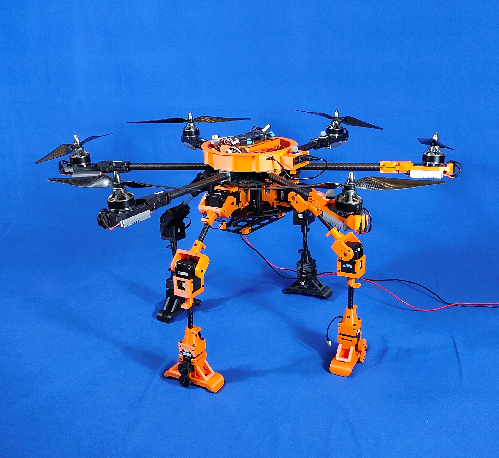
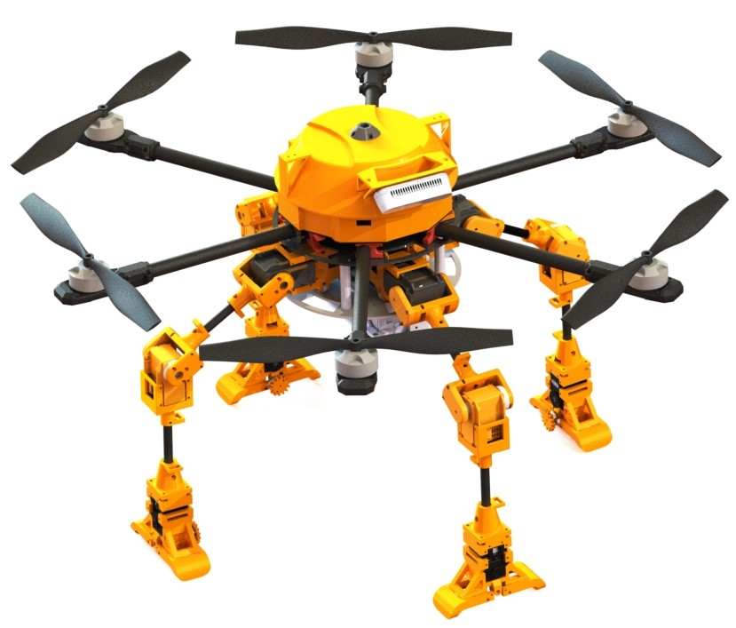
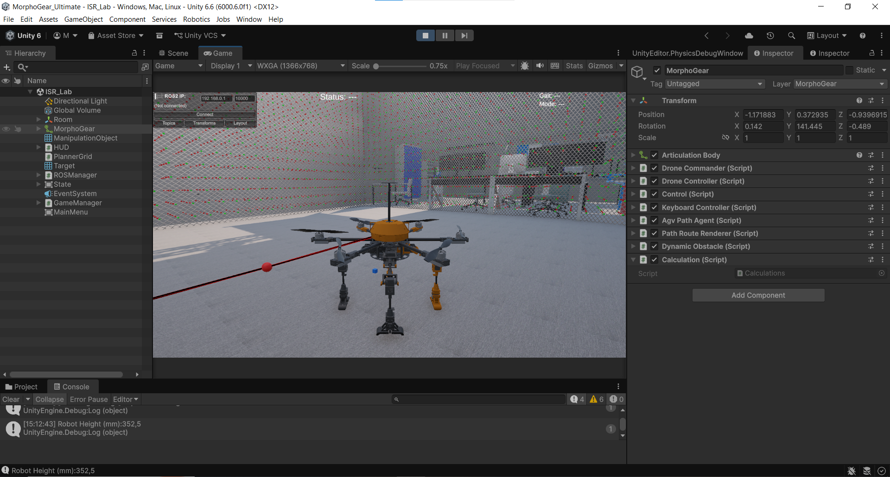
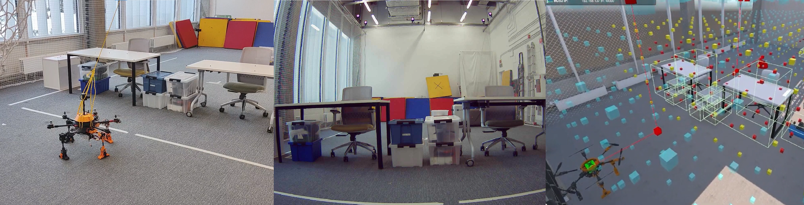

# MorphoGear

<p align="center">
  <strong>An aerial–ground robot with multi-limb morphogenetic landing gear</strong>
</p>

<p align="center">
  <a href="https://github.com/mikk686/morphogear/blob/main/LICENSE">
    
  </a>
  
  
  
  
</p>

<p align="center">
  
</p>

## Overview

**MorphoGear** is a multimodal aerial–ground robotic platform capable of flying, walking over uneven terrain, and interacting with objects using four articulated limbs.

The limbs act as morphogenetic landing gear during flight and as pedipulators or manipulators during ground operation. Each limb has three degrees of freedom, giving the platform 12 actuated limb degrees of freedom in total.

This repository contains:

- A **Unity-based digital twin and simulation environment**
- A **ROS 2 control workspace** (`ROS2/src`)
- **C# kinematic and gait control** (`my_csharp_node`)
- **PyTorch-based neural network controllers** for autonomous walking (`walkcontrol`) and flight (`flightcontrol`)
- **Unity–ROS 2 communication** via `ros_tcp_endpoint`
- Hardware interface packages for physical robot deployment (`stm_ros_connector`, `fcu_ros_connector`, `optitrack_connector`, `kmpc`)

> [!NOTE]
> MorphoGear is research software under active development. Interfaces, controls, and configuration files may change.

<p align="center">
  
</p>

## Capabilities

MorphoGear is designed to investigate multimodal robotic operation, including:

- **Aerial locomotion** and learned obstacle-aware flight control
- **Ground locomotion** with depth-based neural walking policies
- **Rough-terrain traversal**
- **Multiple walking gaits** and trajectory-based limb control
- **Morphology adaptation**
- **Object grasping and manipulation**
- **Digital-twin simulation** in Unity with full ROS 2 integration

The MorphoGear platform demonstrates walking with several gait patterns and a step length of up to 210 mm. Further technical details and experimental results are available in the accompanying paper.

## Repository Structure

```text
morphogear/
├── ROS2/
│   └── src/
│       ├── my_csharp_node/       # Core C# (.NET 8) limb & gait controller [Simulation + Hardware]
│       ├── walkcontrol/          # PyTorch walking policy & command converter [Simulation + Hardware]
│       ├── flightcontrol/        # PyTorch learned flight controller [Simulation + Hardware]
│       ├── fcu_ros_connector/    # Flight controller unit (FCU / MAVROS) bridge [Hardware only]
│       ├── stm_ros_connector/    # STM32 servo motor serial bridge [Hardware only]
│       ├── optitrack_connector/  # OptiTrack motion capture pose node [Hardware only]
│       └── kmpc/                 # Kinematic MPC trajectory generator [Experimental / Hardware]
├── Unity/
│   └── morphogear/               # Unity simulation project
│       ├── Assets/
│       │   ├── Laboratory/       # Simulation environment
│       │   ├── Materials/
│       │   ├── Models/
│       │   ├── Prefabs/
│       │   ├── Resources/
│       │   ├── Scenes/
│       │   └── Scripts/
│       │       ├── Flight/
│       │       ├── Locomotion/
│       │       ├── Manipulation/
│       │       ├── PathPlan/
│       │       └── ROS/
│       ├── Packages/
│       └── ProjectSettings/
├── images/
├── LICENSE
└── README.md
```

## Software Requirements

### Unity Simulation

- [Unity Hub](https://unity.com/download)
- A Unity Editor version compatible with `Unity/morphogear/ProjectSettings/ProjectVersion.txt`
- Git (including Git support in the Unity Package Manager)

The Unity project uses packages including Universal Render Pipeline (URP), Unity Input System, AI Navigation, ROS–TCP Connector, ROS visualization tools, and Visual Scripting.

### ROS 2 Environment

- Ubuntu Linux with **ROS 2 Humble** ([installation guide](https://docs.ros.org/en/humble/Installation.html))
- **ROS–TCP Endpoint** (`ros_tcp_endpoint`) for Unity–ROS 2 communication
- **.NET 8 SDK** and **`ros2cs`** (required for `my_csharp_node`)
- **Python 3** with **PyTorch (`torch`)** (required to run the neural network models in `walkcontrol` and `flightcontrol`)

---

## Installation Guide

### 1. Clone the Repository

```bash
git clone https://github.com/mikk686/morphogear.git
cd morphogear
```

### 2. Install .NET 8 and Rcl.NET (`ros2cs`) — *Important*

The core limb and gait controller (`my_csharp_node`) is written in C# targeting **.NET 8** and uses **Rcl.NET** (`ros2cs`). Install the .NET 8 SDK and `ros2cs` global tool before building the ROS 2 workspace:

```bash
# 1. Download and run the official .NET install script for .NET 8.0
wget https://dot.net/v1/dotnet-install.sh
chmod +x dotnet-install.sh
./dotnet-install.sh --channel 8.0

# 2. Add .NET and .NET tools to your PATH
echo 'export DOTNET_ROOT=$HOME/.dotnet' >> ~/.bashrc
echo 'export PATH=$PATH:$HOME/.dotnet:$HOME/.dotnet/tools' >> ~/.bashrc
source ~/.bashrc

# 3. Install ros2cs global tool
dotnet tool install -g ros2cs

# 4. Restore Rcl.NET and project dependencies for my_csharp_node
cd ~/morphogear/ROS2/src/my_csharp_node
dotnet restore
```

> [!IMPORTANT]
> **Target Architecture (`CMakeLists.txt`):**  
> By default, `ROS2/src/my_csharp_node/CMakeLists.txt` publishes for `linux-arm64` (e.g., Orange Pi / ARM SBC). If you are running the simulation on a standard 64-bit x86 PC, change `-r linux-arm64` to `-r linux-x64` in `ROS2/src/my_csharp_node/CMakeLists.txt` before running `colcon build`.

### 3. Install PyTorch and Additional Dependencies

To run the neural network policies in **`walkcontrol`** and **`flightcontrol`**, you **must install PyTorch (`torch`)**:

```bash
# Install colcon and pip
sudo apt update
sudo apt install -y python3-colcon-common-extensions python3-pip

# Install PyTorch (required for walkcontrol and flightcontrol neural network models)
python3 -m pip install torch torchvision
```

<details>
<summary><strong>Additional Tips & Optional Hardware Dependencies</strong></summary>

If you are working with trajectory optimization, quaternion utilities, or deploying to the physical robot hardware, install the following Python packages and MAVROS:

```bash
python3 -m pip install pyserial
python3 -m pip install casadi
python3 -m pip install numpy-quaternion
python3 -m pip install pymavlink
```

For physical flight controller telemetry, also install **MAVROS** (`ros-humble-mavros` and `ros-humble-mavros-extras`) and **Intel RealSense ROS 2** (`ros-humble-realsense2-camera`).
</details>

### 4. Build the ROS 2 Workspace

Make sure `ros_tcp_endpoint` (the `ros2` branch of [Unity-Technologies/ROS-TCP-Endpoint](https://github.com/Unity-Technologies/ROS-TCP-Endpoint)) is present in `ROS2/src` or installed in your sourced workspace, then build:

```bash
cd ~/morphogear/ROS2
source /opt/ros/humble/setup.bash

# For simulation, you only need to build the simulation packages (or run `colcon build` for all):
colcon build --packages-select my_csharp_node walkcontrol flightcontrol
source install/setup.bash
```

### 5. Set Up the Unity Project

1. Open **Unity Hub** and click **Add project from disk**.
2. Select the `morphogear/Unity/morphogear` directory.
3. Allow Unity to import the project and resolve packages (first import may take several minutes).
4. Open the main simulation scene:
   ```text
   Assets/Scenes/ISR_Lab.unity
   ```
5. Verify the ROS IP address and port in **Robotics → ROS Settings** before entering Play mode.

<p align="center">
  
</p>

---

## Running the Nodes

### Simulation Mode (Unity + ROS 2)

To run MorphoGear in the **Unity simulation**, only **four components** are required:

1. **`ros_tcp_endpoint`** — Bridges communication between Unity and ROS 2.
2. **`my_csharp_node`** — Runs the C# inverse kinematics, gait generator, and limb angle controller.
3. **`walkcontrol`** (`control` + `convert`) — Runs the PyTorch walking policy inference and converts velocity/yaw vectors into discrete gait commands.
4. **`flightcontrol`** (`go`) — Runs the PyTorch learned flight policy inference.

> [!NOTE]
> All other packages in `ROS2/src` (`optitrack_connector`, `stm_ros_connector`, `fcu_ros_connector`, `kmpc`, as well as `mavros` and `realsense2_camera`) are dedicated to **physical hardware** and are **not required** for simulation users.

Open separate terminals (sourcing ROS 2 and your workspace in each) and launch the simulation nodes:

#### 1. Start the ROS–TCP Endpoint
```bash
cd ~/morphogear/ROS2
source /opt/ros/humble/setup.bash
source install/setup.bash
ros2 run ros_tcp_endpoint default_server_endpoint
```

#### 2. Start the C# Limb & Gait Controller (`my_csharp_node`)
```bash
cd ~/morphogear/ROS2
source /opt/ros/humble/setup.bash
source install/setup.bash
ros2 run my_csharp_node my_csharp_node
```

#### 3. Start the Walking Controller (`walkcontrol`: `control` + `convert`)
`walkcontrol` requires two nodes—`control` (runs the PyTorch walking policy on depth + pose + waypoint inputs) and `convert` (translates the output `[vx, vy, 0, 0, 0, yaw]` vector into string commands on `/morphogear_sudo_cmd`):

```bash
# Terminal 3a — Walking policy inference node
cd ~/morphogear/ROS2
source /opt/ros/humble/setup.bash
source install/setup.bash
ros2 run walkcontrol control --ros-args -p depth_input_width:=480 -p depth_input_height:=270
```
*(Tip: If your workspace path differs from the default checkpoint path, pass `-p model_path:=/path/to/ROS2/src/walkcontrol/walkcontrol/policy_003500.pt`.)*

```bash
# Terminal 3b — Walk vector to command string converter
cd ~/morphogear/ROS2
source /opt/ros/humble/setup.bash
source install/setup.bash
ros2 run walkcontrol convert
```

#### 4. Start the Flight Controller (`flightcontrol`)
```bash
cd ~/morphogear/ROS2
source /opt/ros/humble/setup.bash
source install/setup.bash
ros2 run flightcontrol go
```

Once these nodes are running, press **Play** in the Unity Editor (`Assets/Scenes/ISR_Lab.unity`).

---

### Hardware-Only Nodes (Physical Robot Reference)

The remaining nodes in the repository interface with onboard sensors, actuators, and motion capture hardware on the physical robot and are **not needed in simulation**:

| Package / Node | Purpose (Hardware Only) |
|---|---|
| `optitrack_connector` (`get_pose`) | Streams robot pose from the OptiTrack motion capture system |
| `stm_ros_connector` (`connect`) | Serial communication bridge to the STM32 limb servo controller |
| `realsense2_camera` | Launches the onboard Intel RealSense depth camera (`480x270 @ 15 FPS`) |
| `mavros` (`mavros_node`) | Communicates with the onboard Flight Controller Unit over UART (`/dev/ttyS6`) |
| `fcu_ros_connector` (`set_origin.py`, `adapter`) | Sets the EKF origin and bridges flight control commands to MAVROS |

<details>
<summary><strong>Click to view Hardware Launch Commands Reference</strong></summary>

```bash
# OptiTrack Pose Node
ros2 run optitrack_connector get_pose

# STM32 Servo Connector
ros2 run stm_ros_connector connect

# Intel RealSense Depth Camera
ros2 launch realsense2_camera rs_launch.py \
  initial_reset:=true \
  enable_sync:=false \
  enable_color:=false \
  enable_infra1:=false \
  enable_infra2:=false \
  enable_gyro:=false \
  enable_accel:=false \
  enable_depth:=true \
  depth_module.depth_profile:=480x270x15 \
  clip_distance:=-1.0 \
  publish_tf:=false

# MAVROS Node
ros2 run mavros mavros_node --ros-args -p fcu_url:=/dev/ttyS6:57600

# FCU Origin & Adapter
python3 src/fcu_ros_connector/fcu_ros_connector/set_origin.py
ros2 run fcu_ros_connector adapter

# Record Rosbag & Compress Experiments
ros2 bag record -a
tar -I "pigz -1" -cf experiments.tar.gz experiments
```
</details>

---

## ROS 2 Interface Overview

### Key Topics in Simulation

| Topic | Message Type | Description |
|---|---|---|
| `/keyboard_state` | `std_msgs/msg/String` | Per-frame keyboard input state from Unity |
| `/morphogear_sudo_cmd` | `std_msgs/msg/String` | High-level gait/limb command interface (subscribed by `my_csharp_node`, published by `walkcontrol convert`) |
| `/morphogear_sudo_manual` | `std_msgs/msg/Bool` | Switch between manual and autonomous/internal control |
| `/angles_control` | `std_msgs/msg/Int8MultiArray` | Target limb joint angles published by `my_csharp_node` (~20 Hz) |
| `/robot_state` | `std_msgs/msg/String` | Robot state telemetry published by `my_csharp_node` (~10 Hz) |
| `/camera/camera/depth/image_rect_raw` | `sensor_msgs/msg/Image` | Depth image input for `walkcontrol` and `flightcontrol` |
| `/mavros/vision_pose/pose` | `geometry_msgs/msg/PoseStamped` | Robot pose in world frame (ENU) |
| `/b3/waypoint` | `geometry_msgs/msg/PoseStamped` | Target navigation waypoint for walking/flight policies |
| `/nn/enable` | `std_msgs/msg/Bool` | Enables/disables neural network policy inference |
| `/walk/control` | `std_msgs/msg/Float32MultiArray` | 6D walk vector `[vx, vy, 0, 0, 0, yaw_target]` from `walkcontrol control` to `walkcontrol convert` |
| `/motion` | `std_msgs/msg/String` | JSON velocity & yaw command published by `flightcontrol go` |

You can inspect active nodes and topics at runtime using:

```bash
ros2 node list
ros2 topic list
ros2 topic echo /robot_state
ros2 topic echo /morphogear_sudo_cmd
```

<p align="center">
  
</p>

## Troubleshooting

### `.NET` build targets the wrong architecture
`ROS2/src/my_csharp_node/CMakeLists.txt` defaults to `linux-arm64`. For x86_64 machines, edit `CMakeLists.txt` to use `-r linux-x64`, then clean and rebuild:

```bash
cd ~/morphogear/ROS2
rm -rf build install log
source /opt/ros/humble/setup.bash
colcon build
source install/setup.bash
```

### `ModuleNotFoundError: No module named 'torch'`
Ensure PyTorch is installed in the system Python environment used by ROS 2 Humble (`/usr/bin/python3`):
```bash
python3 -m pip install torch torchvision
```

### `walkcontrol` cannot find the policy checkpoint
By default, `walkcontrol` looks for `policy_003500.pt` at `/home/orangepi/ros2_ws/src/walkcontrol/walkcontrol/policy_003500.pt`. Override `model_path` via `--ros-args`:
```bash
ros2 run walkcontrol control --ros-args \
  -p depth_input_width:=480 \
  -p depth_input_height:=270 \
  -p model_path:=$(pwd)/src/walkcontrol/walkcontrol/policy_003500.pt
```

### Unity does not communicate with ROS 2
- Verify `ros2 run ros_tcp_endpoint default_server_endpoint` is running.
- Check that the IP address and port in Unity (**Robotics → ROS Settings**) match the endpoint.
- Ensure no firewall is blocking the TCP port between the Unity and ROS 2 machines.

## Citation

If you use MorphoGear in academic work, please cite:

> M. Martynov, Z. Darush, A. Fedoseev, and D. Tsetserukou,  
> “MorphoGear: An UAV with Multi-Limb Morphogenetic Gear for Rough-Terrain Locomotion,”  
> in *2023 IEEE/ASME International Conference on Advanced Intelligent Mechatronics (AIM)*, 2023, pp. 11–16.  
> [10.1109/AIM46323.2023.10196115](https://doi.org/10.1109/AIM46323.2023.10196115)

### BibTeX

```bibtex
@inproceedings{martynov2023morphogear,
  author    = {Mikhail Martynov and Zhanibek Darush and
               Aleksey Fedoseev and Dzmitry Tsetserukou},
  title     = {{MorphoGear}: An {UAV} with Multi-Limb Morphogenetic
               Gear for Rough-Terrain Locomotion},
  booktitle = {2023 IEEE/ASME International Conference on
               Advanced Intelligent Mechatronics (AIM)},
  year      = {2023},
  pages     = {11--16},
  url       = {https://doi.org/10.1109/AIM46323.2023.10196115}
}
```

The arXiv version may also be cited directly:

```bibtex
@article{martynov2024morphogear,
  author        = {Mikhail Martynov and Zhanibek Darush and
                   Aleksey Fedoseev and Dzmitry Tsetserukou},
  title         = {{MorphoGear}: An {UAV} with Multi-Limb Morphogenetic
                   Gear for Rough-Terrain Locomotion},
  journal       = {arXiv preprint arXiv:2403.08340},
  year          = {2024},
  eprint        = {2403.08340},
  archivePrefix = {arXiv},
  primaryClass  = {cs.RO},
  url           = {https://arxiv.org/abs/2403.08340}
}
```

## Contributing

Contributions, bug reports, and improvements are welcome.

1. Fork the repository.
2. Create a feature branch (`git checkout -b feature/my-improvement`).
3. Commit your changes.
4. Push the branch to your fork and open a pull request.

## License

This project is distributed under the [MIT License](LICENSE).

Copyright © 2026 Mikhail Martynov.
